# Online Exam Platform

A full stack web app where admins create exams and students take them with a countdown timer. The score is counted on the server, and the exam time is also checked on the server.

Around the app there is a complete DevOps pipeline: every change pushed to GitHub is built, tested, scanned for security problems, packaged in Docker images and deployed automatically. The running app is watched with Prometheus and Grafana.

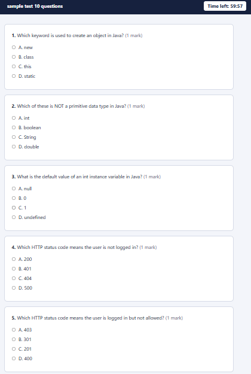

## Contents

- [Features](#features)
- [Architecture](#architecture)
- [Tech stack](#tech-stack)
- [Project structure](#project-structure)
- [Run it on your computer](#run-it-on-your-computer)
- [CI/CD pipeline](#cicd-pipeline)
- [Automatic deployment](#automatic-deployment)
- [Monitoring](#monitoring)
- [Security](#security)
- [API overview](#api-overview)
- [Tests](#tests)
- [Project planning](#project-planning)
- [Known limits and next steps](#known-limits-and-next-steps)

## Features

**Student**
- Register and log in
- See available exams and start one
- Answer multiple-choice questions with a countdown timer (the exam submits by itself when time is over)
- See the score with a review of right and wrong answers
- See all past results

**Admin**
- Create, edit and delete exams
- Add, edit and delete questions
- Import an exam from a text PDF (numbered questions, options A to D, answers; up to 5 MB)
- See the results of all students and filter them by exam

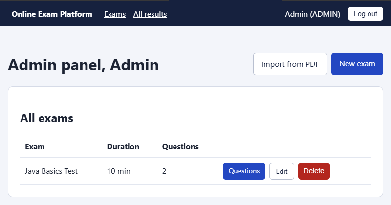

## Architecture

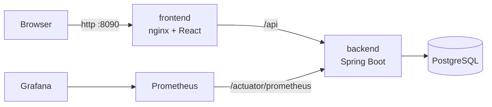

Only the web page (port 8090) is open to the network. The database and the backend have no published ports. Prometheus (9090) and Grafana (3001) listen on `127.0.0.1` only.

## Tech stack

| Part | Technology |
|---|---|
| Frontend | React 19, Vite, React Router, Axios |
| Backend | Java 21, Spring Boot, Spring Security, Spring Data JPA |
| Database | H2 for development, PostgreSQL 16 in Docker |
| Auth | JWT (jjwt), BCrypt |
| PDF import | Apache PDFBox |
| Tests and quality | JUnit 5, Mockito, AssertJ, JaCoCo, ESLint |
| Containers | Docker (multi-stage builds), Docker Compose, nginx |
| CI/CD | GitHub, Jenkins (pipeline as code) |
| Security scans | Trivy (images and secrets), npm audit |
| Deployment | Ansible |
| Monitoring | Spring Boot Actuator, Prometheus, Grafana |

## Project structure

```
online-exam/
├── backend/exam-backend/    Spring Boot REST API (Dockerfile inside)
├── frontend/                React app and nginx config (Dockerfile inside)
├── deploy/
│   ├── docker-compose.prod.yml   production stack (app, database, monitoring)
│   ├── ansible/                  deployment playbook
│   └── monitoring/               Prometheus and Grafana images and dashboard
├── jenkins/                 Jenkins image and compose file
├── docker-compose.yml       development stack
├── Jenkinsfile              the CI/CD pipeline
└── .env.example             names of the settings for the development stack
```

## Run it on your computer

### With Docker (recommended)

```bash
copy .env.example .env      # Windows. On Linux or Mac use: cp .env.example .env
# then set DB_PASSWORD and JWT_SECRET in .env
docker compose up -d --build
```

Open http://localhost:3000

### Without Docker

You need Java 21, Maven and Node.js 18 or newer.

```bash
# 1. Backend
cd backend/exam-backend
./mvnw spring-boot:run          # http://localhost:8080

# 2. Frontend (second terminal)
cd frontend
npm install
npm run dev                     # http://localhost:5173
```

### Sample accounts (development only)

| Role | Email | Password |
|---|---|---|
| Admin | admin@exam.com | admin123 |
| Student | student@exam.com | student123 |

These accounts exist only in the development setup. The production deployment has no sample accounts. New accounts made on the register page are always students.

## CI/CD pipeline

Jenkins runs in a container (`jenkins/`) and checks GitHub every 2 minutes. Start it with:

```bash
cd jenkins
docker compose up -d --build        # http://localhost:8081
```

Every change on `main` goes through these stages:

| No | Stage | What it does |
|---|---|---|
| 1 | Check tools | Versions of Java, Node, npm, Docker and Compose |
| 2 | Backend: build, test and coverage | Maven verify, JUnit tests, JaCoCo coverage gate |
| 3 | Frontend: install, lint and build | npm ci, ESLint, Vite build |
| 4 | Security: frontend packages | npm audit, fails on CRITICAL |
| 5 | Docker: build images | Backend, frontend and monitoring images, tagged with the build number |
| 6 | Security: scan Docker images | Trivy, fails on CRITICAL |
| 7 | Security: secrets in the code | Trivy secret scan of the repository |
| 8 | Docker: check compose file | Validates the Compose file |
| 9 | Deploy | Ansible playbook with smoke tests |

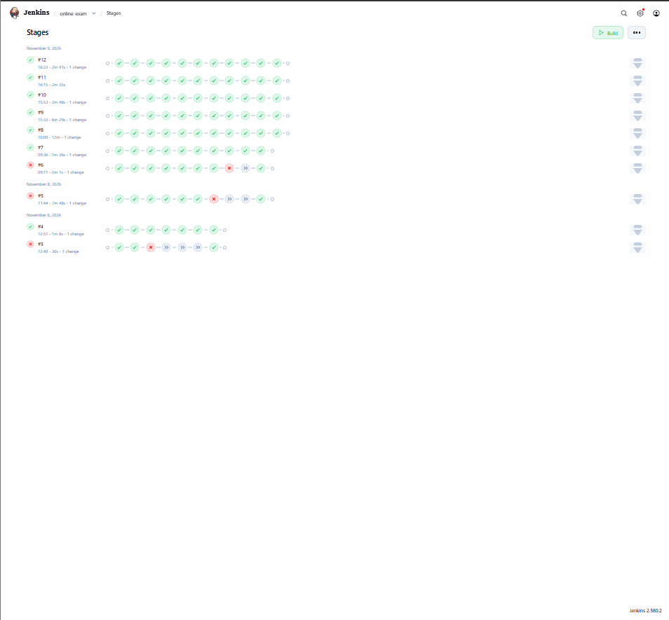

## Automatic deployment

The Deploy stage runs an Ansible playbook (`deploy/ansible/deploy.yml`). It checks that all secrets are present and strong enough, starts the production stack with Docker Compose using the images that were just built and scanned, waits until every container is healthy, and runs smoke tests. The production stack uses its own project name, volumes and port, so it never touches the development stack.

**Secrets** are stored in Jenkins (Manage Jenkins, Credentials, Global) as "Secret text" and handed to Ansible as environment variables. They are never written to a file or to the code.

| Credential ID | Used for | Minimum length |
|---|---|---|
| `exam-db-password` | PostgreSQL password | 16 |
| `exam-jwt-secret` | Signing login tokens | 32 |
| `exam-admin-password` | Password of the one admin account | 12 |
| `exam-grafana-password` | Grafana admin password | 12 |

Create strong values with `openssl rand -hex 32`.

After a green build:

| What | Address |
|---|---|
| The app | http://localhost:8090 |
| Grafana (user `admin`) | http://localhost:3001 |
| Prometheus | http://localhost:9090 |

**Roll back** by running the playbook again with an older image tag (`IMAGE_TAG`), because every build keeps its own tagged images.

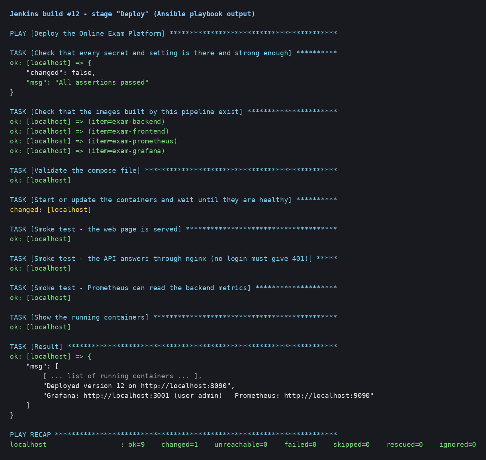

## Monitoring

The backend exposes metrics at `/actuator/prometheus` (reachable only inside the Docker network). Prometheus reads them every 15 seconds, and Grafana shows a ready-made dashboard, "Online Exam Platform - Backend", with:

- backend status and uptime
- requests per second by status
- client (4xx) and server (5xx) errors
- average and 95th-percentile response time
- slowest endpoints
- JVM memory, CPU, database connections and threads

Health checks and Prometheus scrapes are left out of the request panels, so the graphs show real user traffic.

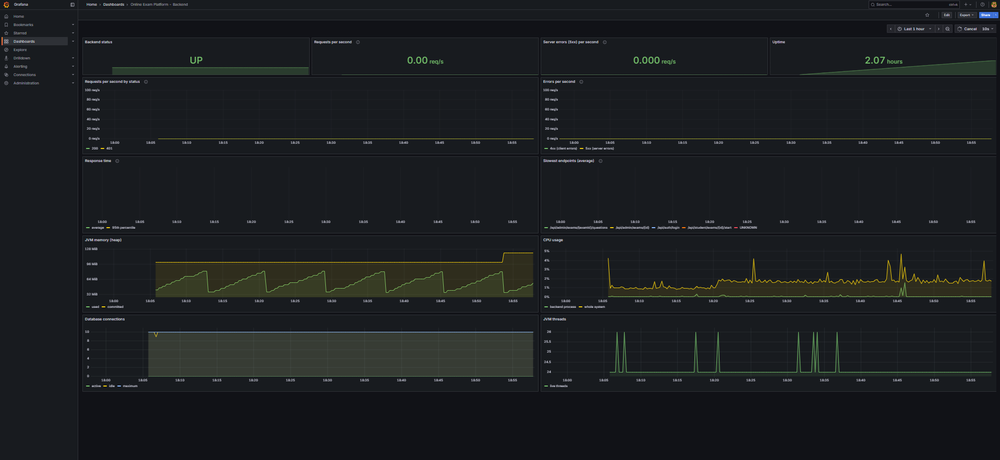

## Security

- Passwords are saved as BCrypt hashes
- JWT tokens for login, with a secret that comes from the environment
- Role-based access: students cannot open admin pages or admin APIs
- Students never receive the correct answers before they submit
- Containers run with health checks, the backend as a non-root user
- Trivy scans the images and the repository, `npm audit` checks the packages
- Production has no sample accounts: the one admin is created from a secret on first start

## API overview

| Method | Endpoint | Who | What it does |
|---|---|---|---|
| POST | /api/auth/register | everyone | Create a student account |
| POST | /api/auth/login | everyone | Log in and get a token |
| GET | /api/student/exams | student | List exams that have questions |
| GET | /api/student/exams/{id}/start | student | Start or continue an exam |
| POST | /api/student/exams/{id}/submit | student | Submit answers and get the score |
| GET | /api/student/results | student | My past results |
| GET, POST | /api/admin/exams | admin | List or create exams |
| GET, PUT, DELETE | /api/admin/exams/{id} | admin | Read, edit or delete an exam |
| POST | /api/admin/exams/import | admin | Create an exam from a PDF |
| GET, POST | /api/admin/exams/{id}/questions | admin | List or add questions |
| PUT, DELETE | /api/admin/questions/{id} | admin | Edit or delete a question |
| GET | /api/admin/results | admin | Results of all students |

## Tests

```bash
cd backend/exam-backend
./mvnw verify          # runs the tests and the JaCoCo coverage check
```

The pipeline runs 45 tests and reports the line coverage (about 65%) on every build.

## Project planning

The work is tracked in Jira: the application (Steps 1 to 9) as a Scrum project with four sprints, and the DevOps work (Steps 10 to 15) as a Kanban board.


## Screenshots

### Student

| Login | Register | Student home |
|---|---|---|
| 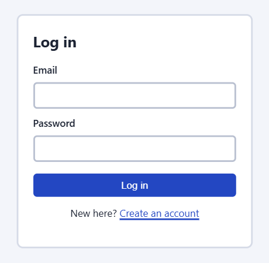 | 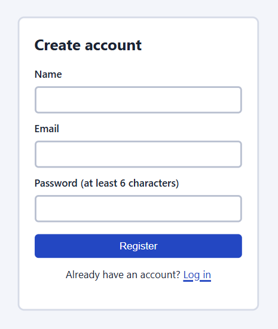 | 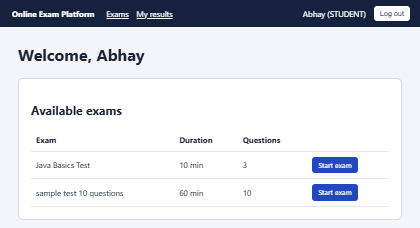 |

| Exam with timer | Score and review | My results |
|---|---|---|
|  | 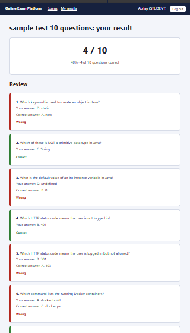 | 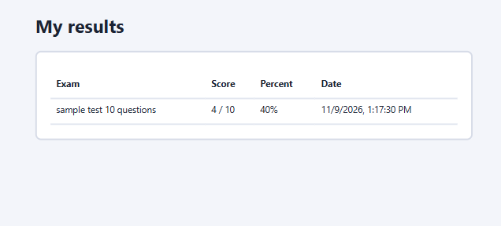 |

### Admin

| Admin home | Questions of an exam | Add a question |
|---|---|---|
|  | 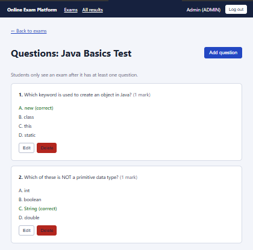 | 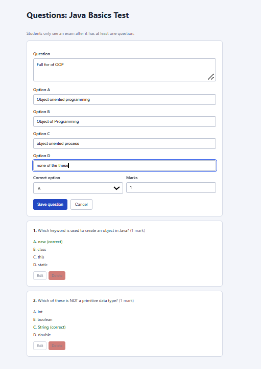 |

| Import from PDF | After the import | All results |
|---|---|---|
| 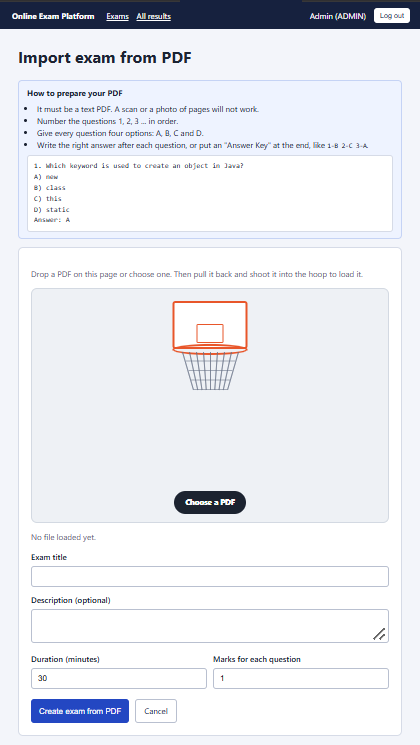 | 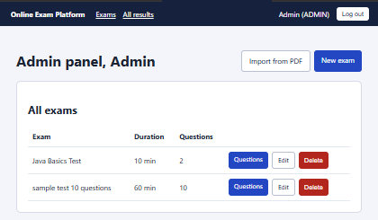 | 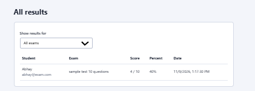 |

### DevOps

| | |
|---|---|
| **GitHub repository**<br>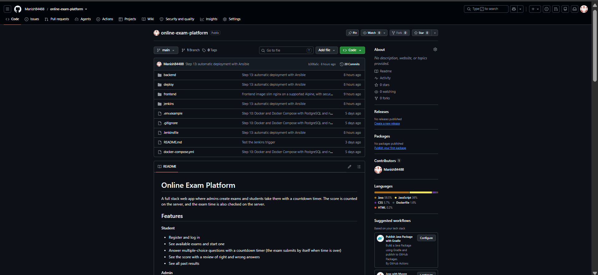 | **Jenkins: tests and coverage**<br>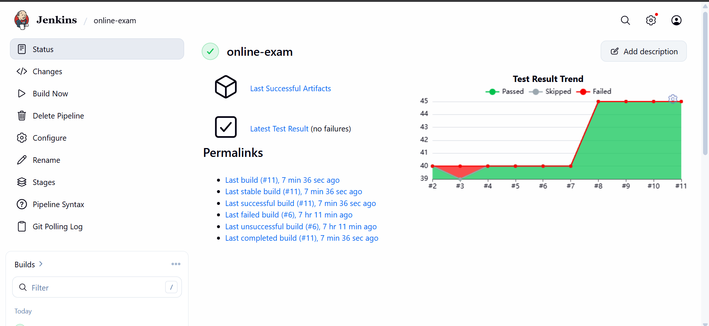 |
| **Jenkins credentials (values hidden)**<br>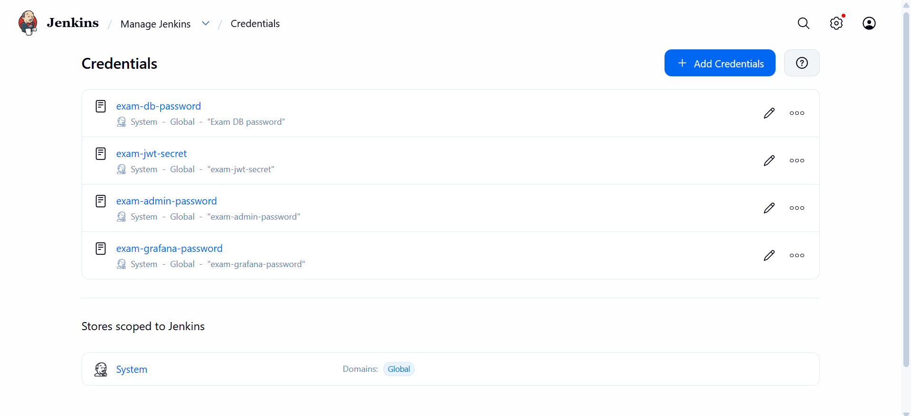 | **Trivy image scan, build 12**<br>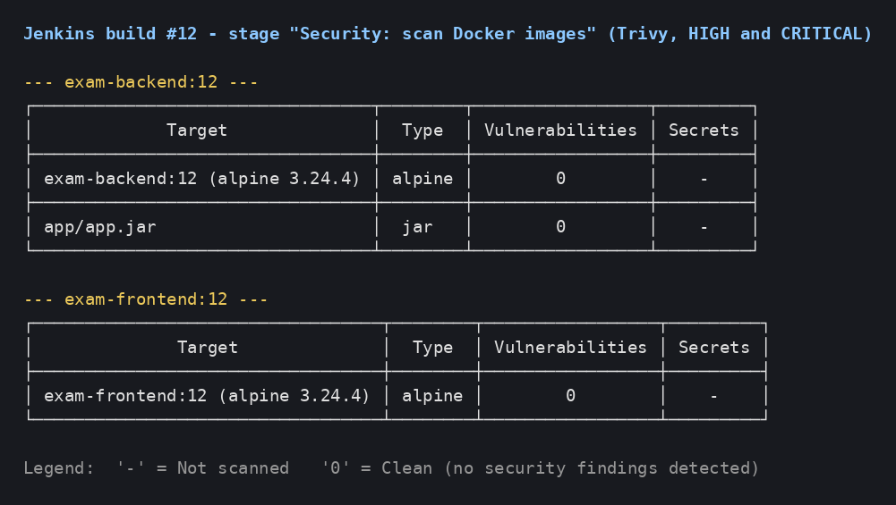 |
| **Running containers**<br>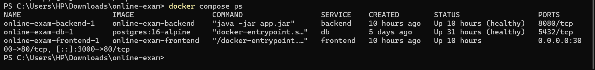 | **Deployed app**<br>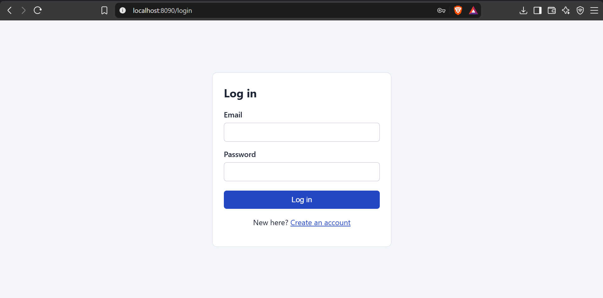 |
| **Prometheus targets**<br>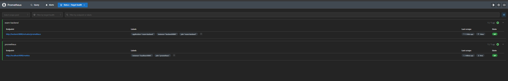 | **Grafana dashboards**<br>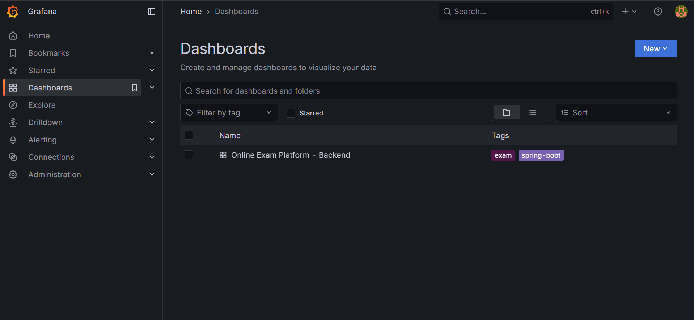 |

## Known limits and next steps

- Raise test coverage (controllers and admin features)
- HTTPS in front of nginx
- A GitHub webhook instead of polling, once Jenkins runs on a server with a public address
- Terraform description of the containers (optional)
- Database backups and Grafana alerts

## Author

Manish Bisht
